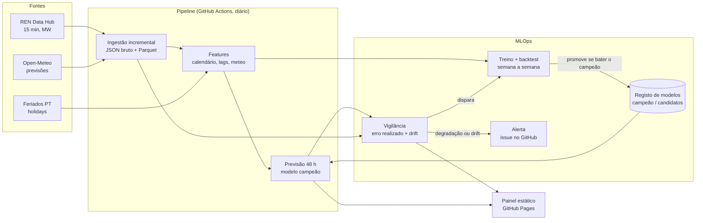

# Previsão da eletricidade em Portugal

Previsão do **consumo** e da **produção eólica e solar** de Portugal continental
para as próximas **24 a 48 horas**, com dados públicos do
[REN Data Hub](https://datahub.ren.pt/), previsões meteorológicas do
[Open-Meteo](https://open-meteo.com/) e o calendário de feriados portugueses.

O objetivo não é só treinar um modelo: é medir, com honestidade, **se ele bate
modelos simples**, e mantê-lo vivo em produção (treino agendado, registo de
modelos, vigilância de drift e da degradação do erro, retreino automático).

> **Painel ao vivo:** <https://joseferrao20.github.io/previsao-eletricidade-pt/>
> (atualizado todos os dias). Todos os números deste README vêm de dados reais
> da REN, processados pelos workflows; nenhum foi escrito à mão.

---

## 1. O problema

A REN, operador da rede de transporte, publica o diagrama de carga a cada 15
minutos: consumo e produção por fonte. Prever estas séries com um a dois dias de
antecedência é útil para quem planeia produção, armazenamento, compras no
mercado diário ou consumo flexível.

| Alvo            | Série REN (15 min, MW)   | Principais fatores               |
|-----------------|--------------------------|----------------------------------|
| `consumo`       | Consumo                  | hora, dia da semana, feriados, temperatura |
| `eolica`        | Eólica                   | vento a 100 m (previsto)         |
| `solar`         | Solar                    | radiação e nebulosidade (previstas), hora solar |

**Formulação.** Todos os dias, à meia-noite (hora de Lisboa), é emitida uma
previsão horária para o dia D e o dia D+1 (horizontes de 1 a 48 h), usando só a
informação disponível nesse momento: valores reais até ao fim de D-1 e
previsões meteorológicas já publicadas antes de D.

## 2. Fontes de dados (verificadas)

| Fonte | Endpoint | Notas |
|-------|----------|-------|
| REN Data Hub | `GET https://servicebus.ren.pt/datahubapi/electricity/ElectricityProductionBreakdownDaily?date=AAAA-MM-DD&culture=pt-PT` | Pública, sem autenticação. JSON tipo Highcharts: `xAxis.categories` (96 intervalos de 15 min) e `series[{name, data}]` em MW. Um pedido por dia. |
| Open-Meteo *Previous Runs* | `GET https://previous-runs-api.open-meteo.com/v1/forecast` com `<variável>_previous_dayN` | Previsões **tal como eram conhecidas N dias antes**. A mesma API serve o treino, o backtest e a produção, por isso o modelo nunca vê meteorologia melhor do que a que teria. Variáveis: temperatura, vento a 100 m, radiação, nebulosidade, em 9 pontos. |
| Feriados | biblioteca [`holidays`](https://pypi.org/project/holidays/) (`PT`) | Regras locais, sem dependência de rede. |

Os endpoints foram confirmados em código público de vários projetos
independentes que usam a mesma API. O formato exato das séries (nomes em
`pt-PT`, mudanças de hora) é validado na ingestão, que falha explicitamente
quando algo não bate certo, em vez de adivinhar (ver `docs/PLANO.md`).

## 3. Arquitetura



## 4. Avaliação honesta

- **Backtest semana a semana** (*rolling origin*): para cada semana de teste, o
  modelo é treinado só com dados anteriores e prevê cada dia dessa semana com a
  mesma regra de emissão usada em produção.
- **Modelos de referência**, avaliados nas mesmas origens e horizontes:
  - *naive sazonal*: o valor à mesma hora, 7 dias antes;
  - *média da semana anterior*: média da mesma hora nos 7 dias antes da emissão;
  - *persistência diária*: o valor à mesma hora no último dia conhecido.
- **Métricas:** MAE (MW), MAPE e sMAPE (%), por alvo e por horizonte
  (D vs. D+1). No solar, o MAPE e o sMAPE são calculados só nas horas com
  produção acima de 100 MW: perto de zero, ambos explodem (no sMAPE, cada hora
  noturna com 1 MW previsto vale 200 %). A tabela indica-o.
- **Skill** face ao naive sazonal: `1 - MAE_modelo / MAE_naive_sazonal`. Como o
  naive nem sempre é a referência mais forte, a leitura abaixo compara também
  com o melhor modelo simples de cada alvo.

### Resultados

A tabela entre os marcadores é escrita por
`eletricidade backtest --atualizar-readme` (workflow `retreino`, todos os
domingos), por isso pode ter números mais recentes do que a análise que se lhe
segue.

<!-- RESULTADOS:INICIO -->
Backtest semana a semana: 26 semanas de teste, de 2026-05-04 a 2026-11-01; horizontes D e D+1 agregados. MAPE e sMAPE do solar só nas horas com mais de 100 MW.

| Alvo | Modelo | MAE (MW) | MAPE | sMAPE | Skill vs. naive sazonal |
|------|--------|---------:|-----:|------:|------------------------:|
| consumo | **LightGBM** | 189 | 3.2% | 3.2% | +35.9% |
| consumo | Naive sazonal (7 dias) | 295 | 4.9% | 5.0% | +0.0% |
| consumo | Média da semana anterior | 422 | 7.3% | 7.1% | -43.2% |
| consumo | Persistência (D-1) | 508 | 8.7% | 8.6% | -72.2% |
| eolica | **LightGBM** | 420 | 83.2% | 48.1% | +48.5% |
| eolica | Naive sazonal (7 dias) | 814 | 153.8% | 75.0% | +0.0% |
| eolica | Média da semana anterior | 636 | 126.3% | 62.0% | +21.9% |
| eolica | Persistência (D-1) | 662 | 107.5% | 64.0% | +18.7% |
| solar | **LightGBM** | 149 | 17.6% | 16.9% | +33.2% |
| solar | Naive sazonal (7 dias) | 223 | 27.2% | 24.7% | +0.0% |
| solar | Média da semana anterior | 185 | 21.9% | 19.2% | +17.1% |
| solar | Persistência (D-1) | 193 | 21.8% | 20.2% | +13.2% |
<!-- RESULTADOS:FIM -->

**Leitura** (primeiro backtest real: 26 semanas, de maio a novembro de 2026,
4368 horas por alvo e horizonte):

| Alvo | MAE LightGBM, D / D+1 | Melhor modelo simples (MAE) | Skill vs. melhor simples |
|------|----------------------:|-----------------------------|-------------------------:|
| consumo | 174 / 204 MW | naive sazonal (295) | +36 % |
| eolica | 400 / 440 MW | média da semana anterior (636) | +34 % |
| solar | 142 / 156 MW | média da semana anterior (185) | +19 % |

- **Consumo:** o MAPE de 3,2 % é o resultado mais sólido. O naive sazonal
  já capta bem o padrão semanal, e mesmo assim o modelo reduz o erro em
  36 %. A persistência (D-1) é a pior referência, sobretudo em D+1
  (624 MW), porque ignora o fim de semana. Ainda não há análise de onde vem o
  ganho (feriados, temperatura): fica como próximo passo.
- **Eólica:** é onde o modelo mais ganha, porque o vento previsto é
  informação que nenhum modelo simples tem. O MAPE (80 %+) é enganador: há
  muitas horas com pouca produção, onde o erro relativo explode. Para a eólica,
  o MAE é a métrica que conta.
- **Solar:** o ganho é o mais pequeno. Uma explicação plausível, ainda por
  confirmar: em dias de céu limpo o dia anterior já é uma boa previsão, e a
  radiação prevista só acrescenta nos dias com nuvens. O período de teste
  (maio a novembro) não inclui o inverno.
- De D para D+1 o erro sobe 8 a 17 %, em linha com a meteorologia mais
  antiga (previsão de 3 dias antes em vez de 2).

## 5. MLOps

| Workflow | Quando | O que faz |
|----------|--------|-----------|
| `ci` | cada *push* / PR | `ruff` + `pytest` no ambiente do `uv.lock`. |
| `diario` | todos os dias, 01:10 UTC | Ingestão incremental (REN + Open-Meteo), previsão a 48 h com o campeão, monitor, painel no GitHub Pages. Se o monitor der alerta, abre/atualiza uma *issue* `alerta-modelo` e dispara o `retreino`. |
| `retreino` | domingos + a pedido do monitor | Backtest de 26 semanas (atualiza a tabela deste README), treina candidatos e aplica a regra de promoção. |

**Registo de modelos** (`src/eletricidade/registo.py`): cada versão guarda o
modelo e um `meta.json` com o período de treino, hiperparâmetros, *seed*,
*commit*, versões das bibliotecas, métricas do backtest e o perfil (decis) das
features usado no cálculo do drift. `campeoes.json` aponta para a versão em
produção e `historico.jsonl` regista cada decisão.

**Regra de promoção.** Um candidato só passa a campeão se, num backtest semana
a semana das últimas 4 semanas, (1) bater o naive sazonal e (2) não for mais de
2 % pior do que o erro **realizado** do campeão nas mesmas horas. Nenhum dos dois
viu esses dados no treino.

**Monitor** (`src/eletricidade/monitor.py`). O erro decide; o drift explica.
- **Alertas** (abrem *issue* e disparam o retreino), em janelas de 7 dias:
  - degradação: MAE realizado > 1,3 × MAE de referência do backtest do campeão;
  - pior do que o naive sazonal nas mesmas horas.
- **Avisos de drift** (aparecem no relatório e no painel, sem retreino): PSI >
  0,25 na meteorologia prevista dos últimos 14 dias face ao **mesmo intervalo
  do calendário** (±7 dias) nos dados anteriores.

A primeira versão comparava a semana recente com todo o treino e em todas as
features. Na primeira execução real deu "drift" em tudo: no mês, no dia do ano,
na temperatura de novembro. Seria um alerta e um retreino por dia. Por isso, o
calendário e os lags do próprio alvo ficaram de fora (a mudança do alvo já se
mede no erro), e a referência passou a ser sazonal.

**Onde fica cada coisa.** O código fica em `main`. O estado de produção
(registo, previsões emitidas, relatórios do monitor, resultados do backtest)
fica no branch `estado`, escrito só pelos workflows. Os JSON brutos da REN e do
Open-Meteo ficam na *cache* do Actions e são reconstruíveis.

## 6. Reprodutibilidade

- Ambiente fixado com [`uv`](https://docs.astral.sh/uv/) (`uv.lock`, `uv sync --frozen`)
  e Python 3.13 (`.python-version`).
- `SEED = 42`, LightGBM com `deterministic=True` e número de *threads* fixo; há
  um teste que corre o backtest duas vezes e exige previsões idênticas.
- Os dados brutos são guardados tal como chegam; o processamento reconstrói-se
  a partir deles (`ren.construir_horario`, `meteo.construir_horario`).
- A meteorologia usa a mesma regra no treino, no backtest e em produção.

## 7. Limitações

Observadas nas primeiras execuções reais:

- O backtest de 26 semanas cobre de maio a novembro: ainda não há avaliação
  num inverno inteiro, que é a época mais difícil para o consumo (frio) e para
  a solar (nuvens).
- O gateway da REN não responde se o pedido tiver `Accept: application/json`
  (fica pendurado até ao timeout). É um comportamento sem documentação, que
  pode mudar. O workflow `diagnostico-rede` serve para o voltar a verificar.
- Alguns dias devolvem 404 de forma intermitente (por exemplo 2024-10-17 na
  primeira tentativa); o *retry* resolve. O dia corrente devolve 404 até a
  REN o publicar.
- O Open-Meteo *Previous Runs* teve vários timeouts nos pedidos mensais; o
  *retry* resolveu todos.

Conhecidas à partida:

- A API da REN não tem documentação formal de contrato: os nomes das séries e o
  formato podem mudar. A ingestão falha de forma explícita em vez de adivinhar.
- Os dias de mudança de hora têm 92 ou 100 intervalos; são tratados em UTC.
- A meteorologia é amostrada em 9 pontos representativos (não é uma média
  ponderada pela potência instalada).
- Para garantir que nenhuma corrida meteorológica usada é posterior à emissão,
  o alvo em D usa a previsão feita 2 dias antes e D+1 a feita 3 dias antes. Na
  prática existem previsões mais frescas, por isso o erro reportado é
  **conservador**: um sistema operacional poderia fazer um pouco melhor.
- O arquivo de previsões do Open-Meteo só cobre bem 2024 em diante: o histórico
  de treino é curto (pouco mais de dois anos), sobretudo para eventos raros.
- A potência instalada solar cresce depressa: modelos treinados no passado
  subestimam o futuro. É uma das razões para o retreino frequente.
- Termos de utilização: o REN Data Hub não publica licença de reutilização.
  Por isso os dados brutos **não** são versionados; o painel mostra só agregados
  horários recentes, com atribuição.

## 8. Como correr

```bash
uv sync --frozen             # ambiente exatamente igual ao do lock
uv run pytest                # testes (fixtures sintéticas, sem rede)
uv run eletricidade ingest   # download incremental desde 2024-01-01
uv run eletricidade backtest --semanas 26
uv run eletricidade treinar
uv run eletricidade prever
uv run eletricidade monitorizar
uv run eletricidade painel   # gera site/index.html
```

Para ativar no GitHub: *Settings → Pages → Source: GitHub Actions*; depois
correr o workflow `diario` à mão uma vez (o primeiro treino é feito
automaticamente se não houver campeão).

Ver o plano detalhado e a investigação dos dados em [`docs/PLANO.md`](docs/PLANO.md).
