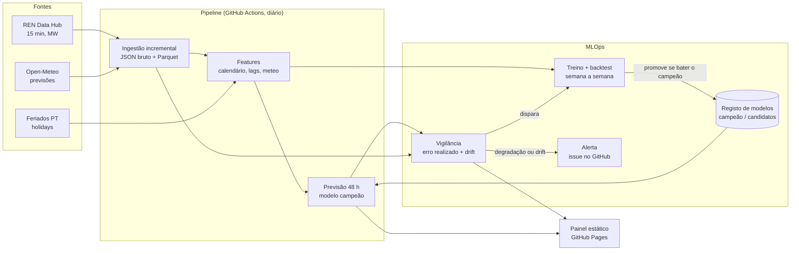

# Previsão da eletricidade em Portugal

Previsão do **consumo** e da **produção eólica e solar** de Portugal continental
para as próximas **24 a 48 horas**, com dados públicos do
[REN Data Hub](https://datahub.ren.pt/), previsões meteorológicas do
[Open-Meteo](https://open-meteo.com/) e o calendário de feriados portugueses.

O objetivo não é só treinar um modelo: é medir, com honestidade, **se ele bate
modelos simples**, e mantê-lo vivo em produção (treino agendado, registo de
modelos, vigilância de drift e da degradação do erro, retreino automático).

> **Estado:** em construção. Os resultados só aparecem no README depois de
> correrem sobre dados reais da REN. Não há números inventados neste repositório.

---

## 1. O problema

A REN, operador da rede de transporte, publica o diagrama de carga a cada 15
minutos: consumo e produção por fonte. Prever estas séries com um a dois dias de
antecedência é útil para quem planeia produção, armazenamento, compras no
mercado diário ou consumo flexível.

| Alvo            | Série REN (15 min, MW)   | Principais fatores               |
|-----------------|--------------------------|----------------------------------|
| `consumo`       | Consumo                  | hora, dia da semana, feriados, temperatura |
| `eolica`        | Eólica                   | vento a 100 m (previsto)         |
| `solar`         | Solar                    | radiação e nebulosidade (previstas), hora solar |

**Formulação.** Todos os dias, à meia-noite (hora de Lisboa), é emitida uma
previsão horária para o dia D e o dia D+1 (horizontes de 1 a 48 h), usando só a
informação disponível nesse momento: valores reais até ao fim de D-1 e a
previsão meteorológica emitida antes de D.

## 2. Fontes de dados (verificadas)

| Fonte | Endpoint | Notas |
|-------|----------|-------|
| REN Data Hub | `GET https://servicebus.ren.pt/datahubapi/electricity/ElectricityProductionBreakdownDaily?date=AAAA-MM-DD&culture=pt-PT` | Pública, sem autenticação. JSON tipo Highcharts: `xAxis.categories` (96 intervalos de 15 min) e `series[{name, data}]` em MW. Um pedido por dia. |
| Open-Meteo (previsão) | `GET https://api.open-meteo.com/v1/forecast` | Previsão para os próximos dias (produção diária). |
| Open-Meteo (arquivo de previsões) | `GET https://historical-forecast-api.open-meteo.com/v1/forecast` | Previsões **tal como foram emitidas** no passado. Usadas no treino e no backtest para não dar ao modelo meteorologia "perfeita" que ele não teria. |
| Feriados | biblioteca [`holidays`](https://pypi.org/project/holidays/) (`PT`) | Regras locais, sem dependência de rede. |

Os endpoints foram confirmados em código público de vários projetos
independentes que usam a mesma API. O formato exato das séries (nomes em
`pt-PT`, mudanças de hora) é validado por testes e por um passo de verificação
no primeiro download real (ver `docs/PLANO.md`).

## 3. Arquitetura



## 4. Avaliação honesta

- **Backtest semana a semana** (*rolling origin*): para cada semana de teste, o
  modelo é treinado só com dados anteriores e prevê cada dia dessa semana com a
  mesma regra de emissão usada em produção.
- **Modelos de referência**, avaliados nas mesmas origens e horizontes:
  - *naive sazonal*: o valor à mesma hora, 7 dias antes;
  - *média da semana anterior*: média da mesma hora nos 7 dias antes da emissão;
  - *persistência diária*: o valor à mesma hora no último dia conhecido.
- **Métricas:** MAE (MW), MAPE e sMAPE (%), por alvo e por horizonte
  (D vs. D+1). No solar o MAPE é calculado só nas horas com produção relevante,
  porque explode quando o valor real é quase zero (isto é dito na tabela).
- **Skill** face ao melhor modelo simples: `1 - MAE_modelo / MAE_referência`.

### Resultados

*A tabela é gerada automaticamente por `make backtest` e só será preenchida
com dados reais.*

| Alvo | Modelo | MAE (MW) | MAPE | sMAPE | Skill vs. naive sazonal |
|------|--------|---------:|-----:|------:|------------------------:|
| —    | —      | —        | —    | —     | —                       |

## 5. MLOps

| Workflow | Quando | O que faz |
|----------|--------|-----------|
| `ingest` | diário | Descarrega os dias em falta da REN e do Open-Meteo (incremental, idempotente). |
| `forecast` | diário | Emite a previsão de 48 h com o modelo campeão e guarda-a. |
| `monitor` | diário | Compara previsões passadas com valores reais; mede drift das variáveis (PSI). Abre uma *issue* se o erro degradar face à referência do backtest, e dispara o retreino. |
| `retrain` | semanal + quando o monitor pede | Treina um candidato, faz backtest nas semanas recentes e só o promove se bater o campeão. |
| `dashboard` | diário | Gera o painel estático e publica-o no GitHub Pages. |

O registo de modelos fica versionado (artefactos + metadados em JSON: dados de
treino, hiperparâmetros, métricas, *commit*, *seed*).

## 6. Reprodutibilidade

- Ambiente fixado com [`uv`](https://docs.astral.sh/uv/) (`uv.lock`) e versão
  de Python fixa (`.python-version`).
- *Seeds* fixas e LightGBM em modo determinístico.
- Dados brutos guardados tal como chegam (JSON da REN), com o processamento
  reconstruível a partir deles.
- Testes com `pytest` em cada *push* (CI).

## 7. Limitações (conhecidas à partida)

- A API da REN não tem documentação formal de contrato: os nomes das séries e o
  formato podem mudar. A ingestão falha de forma explícita em vez de adivinhar.
- Os dias de mudança de hora têm 92 ou 100 intervalos; são tratados em UTC.
- A meteorologia é amostrada em poucos pontos representativos (não é uma média
  ponderada pela potência instalada).
- A potência instalada solar cresce depressa: modelos treinados no passado
  subestimam o futuro. É uma das razões para o retreino frequente.
- Termos de utilização: o REN Data Hub não publica licença de reutilização.
  Por isso os dados brutos **não** são redistribuídos neste repositório; cada
  execução descarrega-os.

## 8. Como correr

```bash
uv sync                      # ambiente exatamente igual ao do lock
uv run pytest                # testes
uv run eletricidade ingest --desde 2023-01-01
uv run eletricidade backtest
```

Ver o plano detalhado em [`docs/PLANO.md`](docs/PLANO.md).
