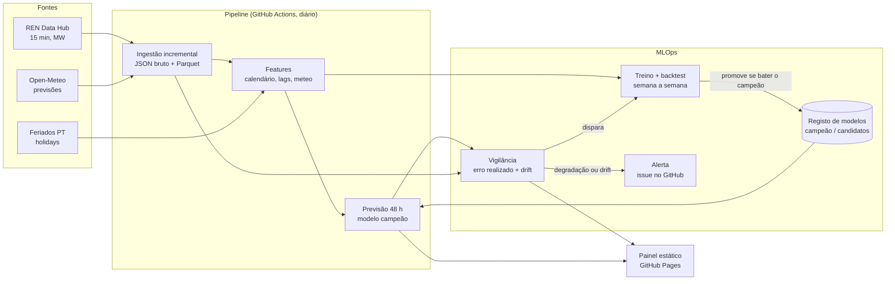

# Previsão da eletricidade em Portugal

Previsão do **consumo** e da **produção eólica e solar** de Portugal continental
para as próximas **24 a 48 horas**, com dados públicos do
[REN Data Hub](https://datahub.ren.pt/), previsões meteorológicas do
[Open-Meteo](https://open-meteo.com/) e o calendário de feriados portugueses.

O objetivo não é só treinar um modelo: é medir, com honestidade, **se ele bate
modelos simples**, e mantê-lo vivo em produção (treino agendado, registo de
modelos, vigilância de drift e da degradação do erro, retreino automático).

> **Painel ao vivo:** <https://joseferrao20.github.io/previsao-eletricidade-pt/>
> (atualizado todos os dias). Todos os números deste README vêm de dados reais
> da REN, processados pelos workflows; nenhum foi escrito à mão.

---

## 1. O problema

A REN, operador da rede de transporte, publica o diagrama de carga a cada 15
minutos: consumo e produção por fonte. Prever estas séries com um a dois dias de
antecedência é útil para quem planeia produção, armazenamento, compras no
mercado diário ou consumo flexível.

| Alvo            | Série REN (15 min, MW)   | Principais fatores               |
|-----------------|--------------------------|----------------------------------|
| `consumo`       | Consumo                  | hora, dia da semana, feriados, temperatura |
| `eolica`        | Eólica                   | vento a 100 m (previsto)         |
| `solar`         | Solar                    | radiação e nebulosidade (previstas), hora solar |

**Formulação.** Todos os dias, à meia-noite (hora de Lisboa), é emitida uma
previsão horária para o dia D e o dia D+1 (horizontes de 1 a 48 h), usando só a
informação disponível nesse momento: valores reais até ao fim de D-1 e
previsões meteorológicas já publicadas antes de D.

## 2. Fontes de dados (verificadas)

| Fonte | Endpoint | Notas |
|-------|----------|-------|
| REN Data Hub | `GET https://servicebus.ren.pt/datahubapi/electricity/ElectricityProductionBreakdownDaily?date=AAAA-MM-DD&culture=pt-PT` | Pública, sem autenticação. JSON tipo Highcharts: `xAxis.categories` (96 intervalos de 15 min) e `series[{name, data}]` em MW. Um pedido por dia. |
| Open-Meteo *Previous Runs* | `GET https://previous-runs-api.open-meteo.com/v1/forecast` com `<variável>_previous_dayN` | Previsões **tal como eram conhecidas N dias antes**. A mesma API serve o treino, o backtest e a produção, por isso o modelo nunca vê meteorologia melhor do que a que teria. Variáveis: temperatura, vento a 100 m, radiação, nebulosidade, em 24 pontos (população, serras com parques eólicos, zonas fotovoltaicas). |
| Feriados | biblioteca [`holidays`](https://pypi.org/project/holidays/) (`PT`) | Regras locais, sem dependência de rede. |

Os endpoints foram confirmados em código público de vários projetos
independentes que usam a mesma API. O formato exato das séries (nomes em
`pt-PT`, mudanças de hora) é validado na ingestão, que falha explicitamente
quando algo não bate certo, em vez de adivinhar (ver `docs/PLANO.md`).

## 3. Arquitetura



## 4. Avaliação honesta

- **Backtest semana a semana** (*rolling origin*): para cada semana de teste, o
  modelo é treinado só com dados anteriores e prevê cada dia dessa semana com a
  mesma regra de emissão usada em produção.
- **Modelos de referência**, avaliados nas mesmas origens e horizontes:
  - *naive sazonal*: o valor à mesma hora, 7 dias antes;
  - *média da semana anterior*: média da mesma hora nos 7 dias antes da emissão;
  - *persistência diária*: o valor à mesma hora no último dia conhecido.
- **Métricas:** MAE (MW), MAPE e sMAPE (%), por alvo e por horizonte
  (D vs. D+1). No solar, o MAPE e o sMAPE são calculados só nas horas com
  produção acima de 100 MW: perto de zero, ambos explodem (no sMAPE, cada hora
  noturna com 1 MW previsto vale 200 %). A tabela indica-o.
- **Skill** face ao naive sazonal: `1 - MAE_modelo / MAE_naive_sazonal`. Como o
  naive nem sempre é a referência mais forte, a leitura abaixo compara também
  com o melhor modelo simples de cada alvo.

### Resultados

A tabela entre os marcadores é escrita por
`eletricidade backtest --atualizar-readme` (workflow `retreino`, todos os
domingos), por isso pode ter números mais recentes do que a análise que se lhe
segue.

<!-- RESULTADOS:INICIO -->
Backtest semana a semana: 52 semanas de teste, de 2025-11-10 a 2026-11-08; horizontes D e D+1 agregados. MAPE e sMAPE do solar só nas horas com mais de 100 MW.

| Alvo | Modelo | MAE (MW) | MAPE | sMAPE | Skill vs. naive sazonal |
|------|--------|---------:|-----:|------:|------------------------:|
| consumo | **LightGBM** | 184 | 2.9% | 2.9% | +47.8% |
| consumo | Naive sazonal (7 dias) | 354 | 5.6% | 5.6% | +0.0% |
| consumo | Média da semana anterior | 467 | 7.7% | 7.5% | -32.2% |
| consumo | Persistência (D-1) | 556 | 9.0% | 9.0% | -57.1% |
| eolica | **LightGBM** | 262 | 31.3% | 25.3% | +76.5% |
| eolica | Naive sazonal (7 dias) | 1114 | 213.5% | 79.7% | +0.0% |
| eolica | Média da semana anterior | 856 | 193.1% | 64.4% | +23.1% |
| eolica | Persistência (D-1) | 922 | 181.7% | 68.9% | +17.2% |
| solar | **LightGBM** | 112 | 18.7% | 17.7% | +49.0% |
| solar | Naive sazonal (7 dias) | 220 | 44.3% | 37.1% | +0.0% |
| solar | Média da semana anterior | 176 | 35.3% | 27.8% | +19.8% |
| solar | Persistência (D-1) | 188 | 36.4% | 30.8% | +14.2% |
<!-- RESULTADOS:FIM -->

**Leitura** (backtest de 2026-11-09, já com as melhorias da secção seguinte:
52 semanas, de novembro de 2025 a novembro de 2026, 8728 previsões por alvo e
horizonte):

| Alvo | MAE LightGBM, D / D+1 | Melhor modelo simples (MAE) | Skill vs. melhor simples |
|------|----------------------:|-----------------------------|-------------------------:|
| consumo | 194 / 220 MW | naive sazonal (351) | +41 % |
| eolica | 325 / 386 MW | média da semana anterior (854) | +58 % |
| solar | 113 / 127 MW | média da semana anterior (175) | +31 % |

Evolução do MAE total (mesmas 52 semanas): consumo 230 → 207 MW, eólica 542 →
355 MW, solar 132 → 120 MW. As experiências que explicam cada salto estão mais
abaixo.

- **Consumo:** MAPE de 3,3 % num ano inteiro. O naive sazonal é a referência
  mais forte, porque já capta o padrão semanal; a persistência (D-1) é a pior,
  sobretudo em D+1 (679 MW), porque ignora o fim de semana.
- **Eólica:** o vento previsto é informação que nenhum modelo simples tem, e é
  onde o modelo mais ganha. O MAPE (~55 %) é enganador: há muitas horas com
  pouca produção, onde o erro relativo explode. Para a eólica, o MAE é a
  métrica que conta.
- **Solar:** MAPE de 21 % com o inverno incluído: os dias de inverno produzem
  pouco, e o erro relativo pesa mais.
- De D para D+1 o erro sobe 12 a 19 %, coerente com a meteorologia mais antiga
  (previsão feita 3 dias antes em vez de 2).

### Onde o modelo ganha

<!-- ANALISE:INICIO -->
MAE (MW) por segmento nas mesmas 52 semanas, horizontes D e D+1 agregados. *Melhor simples* é a melhor das três referências **dentro de cada segmento**, escolhida depois de ver o resultado (comparação deliberadamente exigente). A meteorologia é a prevista na emissão, por isso os segmentos são conhecidos de antemão.

**consumo**

| Segmento | | Previsões | LightGBM | Naive sazonal | Melhor simples | Skill vs. melhor |
|---|---|---:|---:|---:|---:|---:|
| Estação | inverno | 4 320 | 284 | 490 | 490 (naive) | +42% |
| Estação | primavera | 4 400 | 143 | 311 | 311 (naive) | +54% |
| Estação | verão | 4 416 | 156 | 327 | 327 (naive) | +52% |
| Estação | outono | 4 320 | 156 | 288 | 288 (naive) | +46% |
| Tipo de dia | dia útil | 11 896 | 184 | 353 | 353 (naive) | +48% |
| Tipo de dia | fim de semana | 4 796 | 177 | 306 | 306 (naive) | +42% |
| Tipo de dia | feriado | 620 | 220 | 689 | 689 (naive) | +68% |
| Tipo de dia | ponte | 144 | 267 | 554 | 333 (média sem.) | +20% |
| Temperatura prevista | < 10 °C | 1 731 | 229 | 389 | 389 (naive) | +41% |
| Temperatura prevista | 10–20 °C | 10 862 | 184 | 342 | 342 (naive) | +46% |
| Temperatura prevista | 20–28 °C | 4 329 | 161 | 342 | 342 (naive) | +53% |
| Temperatura prevista | ≥ 28 °C | 534 | 234 | 572 | 572 (naive) | +59% |

**eolica**

| Segmento | | Previsões | LightGBM | Naive sazonal | Melhor simples | Skill vs. melhor |
|---|---|---:|---:|---:|---:|---:|
| Estação | inverno | 4 320 | 345 | 1500 | 1092 (média sem.) | +68% |
| Estação | primavera | 4 400 | 274 | 1135 | 853 (média sem.) | +68% |
| Estação | verão | 4 416 | 199 | 690 | 557 (média sem.) | +64% |
| Estação | outono | 4 320 | 231 | 1140 | 929 (média sem.) | +75% |
| Tipo de dia | dia útil | 11 896 | 255 | 1110 | 862 (média sem.) | +70% |
| Tipo de dia | fim de semana | 4 796 | 285 | 1088 | 835 (média sem.) | +66% |
| Tipo de dia | feriado | 620 | 228 | 1273 | 814 (persist.) | +72% |
| Tipo de dia | ponte | 144 | 240 | 1539 | 1264 (média sem.) | +81% |
| Vento previsto a 100 m | < 4 m/s | 8 539 | 190 | 950 | 718 (persist.) | +73% |
| Vento previsto a 100 m | 4–8 m/s | 6 895 | 316 | 1101 | 782 (média sem.) | +60% |
| Vento previsto a 100 m | 8–12 m/s | 1 553 | 384 | 1866 | 1587 (média sem.) | +76% |
| Vento previsto a 100 m | ≥ 12 m/s | 469 | 358 | 1778 | 1353 (persist.) | +74% |

**solar**

| Segmento | | Previsões | LightGBM | Naive sazonal | Melhor simples | Skill vs. melhor |
|---|---|---:|---:|---:|---:|---:|
| Estação | inverno | 4 320 | 73 | 205 | 150 (média sem.) | +51% |
| Estação | primavera | 4 400 | 123 | 222 | 177 (média sem.) | +30% |
| Estação | verão | 4 416 | 141 | 219 | 190 (média sem.) | +26% |
| Estação | outono | 4 320 | 110 | 232 | 188 (média sem.) | +41% |
| Tipo de dia | dia útil | 11 896 | 110 | 223 | 177 (média sem.) | +38% |
| Tipo de dia | fim de semana | 4 796 | 117 | 212 | 178 (média sem.) | +34% |
| Tipo de dia | feriado | 620 | 114 | 203 | 142 (média sem.) | +19% |
| Tipo de dia | ponte | 144 | 92 | 272 | 196 (persist.) | +53% |
| Nebulosidade prevista (horas de sol) | < 20 % | 2 317 | 240 | 420 | 352 (persist.) | +32% |
| Nebulosidade prevista (horas de sol) | 20–60 % | 2 319 | 238 | 412 | 341 (média sem.) | +30% |
| Nebulosidade prevista (horas de sol) | ≥ 60 % | 3 238 | 232 | 518 | 397 (média sem.) | +42% |
<!-- ANALISE:FIM -->

**O que a primeira análise mostrou** (backtest de 2026-11-05, antes das experiências seguintes; a tabela acima já é a atual):

- **Feriados:** é onde o consumo mais ganha (+69 %: 217 vs. 689 MW). O naive
  usa o mesmo dia da semana anterior, que foi dia útil; o modelo sabe que é
  feriado. As pontes são poucas (144 previsões, cerca de 3 dias), por isso o
  +17 % aí vale pouco como evidência.
- **Inverno e frio:** é a época mais difícil para o consumo (MAE 355 MW, contra
  180 a 205 MW nas outras estações). Abaixo de 10 °C previstos o ganho cai
  para +25 %, e acima de 28 °C sobe para +45 %. O aquecimento parece mais
  difícil de prever do que o arrefecimento. É o primeiro sítio onde procurar
  melhorias.
- **Eólica:** ganha entre +31 % e +42 % em todas as estações, e mais (+60 % a
  +68 %) quando o vento previsto é forte, onde as referências falham mais. Nos
  feriados o ganho é só de +12 %, com uma amostra curta (cerca de 13 dias).
- **Solar:** a hipótese anterior (o modelo só ajudaria com nuvens) **não se
  confirma**. O ganho é parecido com céu limpo (+27 %) e muito nublado
  (+25 %), e é menor com nuvens parciais (+18 %), que são o caso mais difícil.
  Por estação, ganha mais no inverno (+31 %) do que na primavera e no verão
  (+19 a 21 %).
- **Vento fraco nos pontos (resolvido):** em 60 % das horas, o vento previsto
  nos 3 pontos iniciais ficava abaixo de 4 m/s a 100 m. Isto apontava para
  pontos mal escolhidos. A experiência seguinte confirmou-o.

#### Experiência: pontos meteorológicos onde está a produção

Antes havia 3 pontos de vento e 3 de sol, e o modelo via só a média de cada
grupo. Agora há 12 pontos nas serras onde se concentram os parques eólicos
(Caramulo, Freita, Montemuro, Alvão, Barroso, Arga, Guarda, Gardunha, Lousã,
Candeeiros, Oeste, Monchique) e 10 nas zonas fotovoltaicas (incluindo Lisboa e
Porto, pela produção em telhados). O LightGBM recebe a série de cada ponto e
aprende o peso de cada um com os dados de treino de cada semana do backtest:
nenhum valor de potência instalada é imposto. A eólica recebe também um proxy de
potência, a média por ponto de min(v, 13 m/s)³: a curva de potência não é
linear, e a média dos cubos não é o cubo da média.

Mesmas 52 semanas, mesmas horas (workflow `avaliar`, `main` contra o branch):

| Alvo | MAE antes | MAE depois | Variação |
|---|---:|---:|---:|
| eolica | 542 MW | 355 MW | **−34 %** |
| solar | 132 MW | 120 MW | −9 % |
| consumo | 230 MW | 230 MW | 0 % (não mudou nada para o consumo) |

Porque é que o vento previsto é tão fraco mesmo nas serras (mediana de 3 a 4 m/s
no Caramulo, na Freita e no Alvão)? A explicação mais provável é a resolução do
modelo meteorológico: cada célula da grelha mistura vales e cumeadas, e as
cumeadas, onde estão os aerogeradores, ficam suavizadas. O nível absoluto sai
baixo, mas as variações continuam informativas, e o modelo aprende a escala. É
coerente com o ganho de 34 %.

#### Experiência: frio e inércia térmica no consumo

A análise por segmento apontava o inverno e o frio como o ponto fraco do
consumo. Juntaram-se features de temperatura ao nível do dia, todas conhecidas na
emissão:
- mínima, máxima e média previstas do dia alvo;
- graus-dia de aquecimento (base 16 °C) e de arrefecimento (base 22 °C);
- inércia térmica: média e graus-dia de aquecimento dos 3 dias anteriores, da
  corrida mais antiga do arquivo para esses dias. Um teste garante que a inércia não usa a previsão do
  próprio dia alvo.

Mesmas 52 semanas e mesmas horas:

| Consumo | MAE antes | MAE depois | Variação |
|---|---:|---:|---:|
| Total | 230 MW | 207 MW | **−10 %** |
| Inverno | 355 MW | 324 MW | −9 % |
| Abaixo de 10 °C | 299 MW | 274 MW | −8 % |
| Acima de 28 °C | 314 MW | 276 MW | −12 % |
| Fim de semana | 240 MW | 202 MW | −16 % |
| Feriados (620 previsões) | 217 MW | 226 MW | +4 % |

Melhora em todas as estações e faixas de temperatura. O inverno continua a ser a
época mais difícil. Nos feriados e nas pontes piora ligeiramente, mas as
amostras são pequenas.

#### Experiência: meteorologia mais fresca

A regra inicial era deliberadamente conservadora: D usava a previsão feita 2
dias antes e D+1 a de 3 dias antes, em todas as horas. A documentação do
Open-Meteo diz que `previous_dayN` é o valor previsto N × 24 h antes da hora
válida. Isso permite saber, hora a hora, que corridas já estavam publicadas à
meia-noite de emissão T0. A regra nova usa, para cada hora t, o menor N com
t − 24·N h + 8 h ≤ T0. As horas 0 a 16 de D passam a usar a previsão de 1 dia
antes, e as de D+1 a de 2 dias antes; as restantes ficam como estavam.

Um teste percorre todas as horas, incluindo os dias de mudança de hora, e
verifica que nenhuma usa uma corrida publicada depois da emissão. Como
verificação, a regra antiga correu no mesmo branch e reproduziu exatamente os
números do `main` (207 / 355 / 120 MW): a nova descarga não mudou mais nada.

Mesmas 52 semanas e mesmas horas:

| Alvo | MAE antes | MAE depois | Variação |
|---|---:|---:|---:|
| eolica | 355 MW | 310 MW | **−13 %** |
| solar | 120 MW | 112 MW | −7 % |
| consumo | 207 MW | 201 MW | −3 % |

A eólica é a que mais ganha, porque depende quase só do vento previsto.

#### Experiência: hiperparâmetros afinados sem ver o teste

Procura aleatória (16 configurações por alvo; a configuração atual é sempre uma
delas). Os parâmetros foram escolhidos só com 8 semanas de validação
anteriores às 52 de teste (maio a outubro de 2025), cada uma treinada só com o
seu passado (`eletricidade afinar`). Regra fixada antes de ver o teste: só se
adota uma alteração com ganho de pelo menos 1 % na validação.

| Alvo | Validação | Teste (52 semanas) |
|---|---:|---:|
| consumo | −2,7 % | 201 → 195 MW (**−3 %**) |
| eolica | −2,0 % | 310 → 301 MW (**−3 %**) |
| solar | −0,6 % (não adotado) | 112 MW (igual) |

Os ganhos de teste confirmam os de validação. Custo: na eólica, os modelos de
quantis ficaram com menos árvores, e o intervalo calibrado alargou de 887 para
958 MW (D), com cobertura parecida. Os parâmetros estão versionados em
`src/eletricidade/hiperparametros.json`.

#### Experiência: vários modelos meteorológicos

Além do modelo de omissão do Open-Meteo, a meteorologia passa a vir também do
ECMWF (IFS 0,25°), do GFS e do ICON:
- cada modelo só é pedido para a variável que interessa a cada grupo de pontos
  (vento a 100 m, radiação, temperatura), para não multiplicar a carga sobre a
  API;
- o modelo recebe a média do grupo por modelo e a **dispersão entre modelos**,
  uma medida direta da incerteza meteorológica;
- antes de escrever código, confirmou-se num runner (workflow
  `diagnostico-rede`) o formato da resposta e o início do arquivo de cada
  modelo: completo desde março de 2024. A Météo-France ficou de fora, porque
  não tem previsão a 2 dias.

Mesmas 52 semanas e mesmas horas:

| Alvo | MAE antes | MAE depois | Variação |
|---|---:|---:|---:|
| eolica | 301 MW | 262 MW | **−13 %** |
| solar | 112 MW | 111 MW | −1 % |
| consumo | 195 MW | 195 MW | 0 % |

Os intervalos da eólica também ficaram mais estreitos (958 → 888 MW em D), com a
mesma cobertura. A primeira ingestão dos três modelos demora cerca de 1 h.

#### Experiência: calendário alargado no consumo

Até aqui, o modelo de consumo só sabia se o dia era feriado, ponte ou fim de
semana. Passou a receber também (`src/eletricidade/calendario.py`, só no
consumo):
- dias até ao próximo feriado e desde o último (limitados a 7), porque a
  semana à volta de um feriado já consome de forma diferente;
- período de Natal (24/12 a 1/1) e as vésperas de Natal e de Ano Novo;
- Santo António (13/6) e São João (24/6), feriados municipais de Lisboa e do
  Porto, com peso nacional;
- Carnaval (terça-feira, 47 dias antes da Páscoa): não é feriado nacional, mas
  é tolerância em muitos sítios.

As férias escolares ficaram de fora, porque não foi possível confirmar aqui o
calendário oficial de cada ano.

Mesmas 52 semanas e mesmas horas (a eólica e o solar não mudam: 262 e 111 MW):

| Consumo, segmento | n | MAE antes | MAE depois | Variação |
|---|---:|---:|---:|---:|
| **Total** | 17456 | 195 MW | 184 MW | **−5,6 %** |
| dia útil | 11896 | 197 | 184 | −6,6 % |
| fim de semana | 4796 | 182 | 177 | −2,7 % |
| feriado | 620 | 232 | 220 | −4,9 % |
| ponte | 144 | 279 | 267 | −4,2 % |
| inverno | 4320 | 309 | 284 | −8,1 % |
| primavera | 4400 | 154 | 143 | −7,1 % |
| verão | 4416 | 162 | 156 | −3,3 % |
| outono | 4320 | 156 | 154 | −0,9 % |
| < 10 °C | 1712 | 262 | 230 | −12,0 % |
| ≥ 28 °C | 534 | 233 | 234 | +0,5 % |

O ganho não vem só dos dias especiais: os dias úteis melhoram tanto como os
feriados, sobretudo no inverno, onde estão o Natal e as semanas à volta dos
feriados de dezembro. Os segmentos de feriado e ponte continuam pequenos (só
um ano), por isso a variação neles deve ser lida com cautela; o critério de
adoção foi o MAE total.

#### Experiência sem ganho: prever em fração da potência instalada

Hipótese: a potência solar e eólica cresce, por isso um modelo treinado no
passado subestima o futuro. Era também a explicação provável para os ~40 % de
horas de solar acima do P90 antes da calibração. Experiência: a eólica e o solar
passaram a ser previstos como fração de um proxy da potência instalada (o
máximo horário dos 90 dias anteriores), com peso igual a esse proxy para a perda
continuar a ser o MAE em MW.

| Alvo | MAE antes | MAE depois | Solar acima do P90 (sem calibrar) |
|---|---:|---:|---:|
| eolica | 310 MW | 309 MW | — |
| solar | 112 MW | 113 MW | 41 % → 40 % |

Sem ganho, e o desvio dos quantis ficou igual: a hipótese não explica o
problema. A explicação mais provável passa a ser as horas noturnas e de
alvorada, em que a produção real é de poucos MW e o P90 é 0. A calibração por
hora já corrige isso. O código não entrou no `main` (ficou no branch
`passo6-alvo-normalizado`): acrescentava complexidade sem benefício.

### Intervalos de previsão

Além do valor central, cada previsão traz um intervalo a 80 % (P10–P90): um
LightGBM com perda quantílica para cada limite. Os quantis sozinhos ficaram
**estreitos de mais** no backtest real: o valor real caía dentro em 63–70 % das
horas, e no solar em ~53 %, com 40 % das horas acima do P90, porque a potência
instalada cresce e o passado subestima o futuro. A correção é uma calibração
conformal (CQR assimétrico):
- cada limite é deslocado pelo quantil 90 % dos erros fora da amostra das 12
  semanas anteriores;
- o deslocamento é calculado por alvo, horizonte e hora do dia;
- no backtest, cada semana é calibrada só com as semanas anteriores; em
  produção, com as 12 mais recentes do último backtest.

Resultado na avaliação de 2026-11-09 (52 semanas, menos as 4 primeiras):

| Alvo | Cobertura sem calibrar | Cobertura calibrada | Largura (MW) | Largura do naive ± erros (cobertura) |
|---|---:|---:|---:|---:|
| consumo (D) | 66 % | 77 % | 645 | 1228 (81 %) |
| eolica (D) | 70 % | 78 % | 1007 | 4524 (87 %) |
| solar (D) | 54 % | 81 % | 370 | 783 (79 %) |

Com cobertura parecida, os intervalos do modelo têm entre um quarto e metade
da largura dos do naive. No consumo ficam ainda um pouco abaixo dos 80 %
nominais.

**Experiência sem ganho: calibração adaptativa (ACI).** A calibração estática
deixa o consumo em ~77 % de cobertura, abaixo dos 80 %. Testou-se a calibração
conformal adaptativa (Gibbs & Candès, 2021): o nível do quantil de cada lado é
corrigido semana a semana pela taxa de falhas da semana anterior, com o passo
(0,5) fixado à partida. Resultado (D, mesmas 52 semanas):

| Alvo | Cobertura estática → adaptativa | Pinball P10/P90 estática → adaptativa |
|---|---:|---:|
| consumo | 77,0 % → 75,2 % | 52/47 → 59/53 |
| eolica | 77,2 % → 79,9 % | 60/75 → 61/77 |
| solar | 81,4 % → 79,8 % | 29/25 → 31/25 |

Na eólica e no solar, a cobertura fica quase exatamente nos 80 %. No consumo,
que era o objetivo, piora, mesmo com intervalos mais largos. A explicação mais
provável é que os erros do consumo vêm em choques (vagas de frio, semanas com
feriados) que a semana anterior não antecipa, e a correção chega atrasada. A
pinball loss, a métrica que equilibra acertar e ser estreito, piora nos três
alvos. Ficou a calibração estática. Escolher a adaptativa só para a eólica e o
solar, depois de ver estes números, seria escolher pelo teste; o código ficou no
branch `passo9-calibracao-adaptativa`.

<!-- INTERVALOS:INICIO -->
Intervalo de previsão a 80 % (quantis 10 % e 90 %) nas mesmas 52 semanas, menos as 4 primeiras (precisam de erros passados para calibrar). Um intervalo bem calibrado contém o valor real em ~80 % das horas, com ~10 % de cada lado; entre intervalos calibrados, o mais estreito é melhor (menor pinball). *Calibrado*: cada limite deslocado pelo quantil 90 % dos erros das 12 semanas anteriores, por alvo, horizonte e hora (calibração conformal).

| Alvo | Horizonte | Intervalo | Cobertura (nominal 80 %) | Abaixo / acima | Largura média (MW) | Pinball P10 / P90 (MW) |
|---|---|---|---:|---:|---:|---:|
| consumo | D | LightGBM (quantis, sem calibrar) | 63.9% | 16.2% / 19.9% | 442 | 47 / 49 |
| consumo | D | Naive ± erros passados | 82.1% | 9.8% / 8.1% | 1273 | 99 / 100 |
| consumo | D | **LightGBM calibrado** | 77.1% | 11.8% / 11.1% | 599 | 47 / 45 |
| consumo | D+1 | LightGBM (quantis, sem calibrar) | 60.5% | 18.3% / 21.2% | 467 | 54 / 57 |
| consumo | D+1 | Naive ± erros passados | 82.2% | 9.7% / 8.1% | 1277 | 99 / 100 |
| consumo | D+1 | **LightGBM calibrado** | 77.1% | 12.1% / 10.8% | 678 | 53 / 51 |
| eolica | D | LightGBM (quantis, sem calibrar) | 82.3% | 9.7% / 8.0% | 989 | 54 / 70 |
| eolica | D | Naive ± erros passados | 87.3% | 6.4% / 6.2% | 4493 | 266 / 272 |
| eolica | D | **LightGBM calibrado** | 77.3% | 11.7% / 11.0% | 879 | 55 / 69 |
| eolica | D+1 | LightGBM (quantis, sem calibrar) | 78.8% | 11.6% / 9.6% | 1007 | 61 / 77 |
| eolica | D+1 | Naive ± erros passados | 87.0% | 6.5% / 6.5% | 4501 | 266 / 276 |
| eolica | D+1 | **LightGBM calibrado** | 77.1% | 11.7% / 11.2% | 957 | 62 / 77 |
| solar | D | LightGBM (quantis, sem calibrar) | 53.7% | 6.1% / 40.2% | 334 | 28 / 27 |
| solar | D | Naive ± erros passados | 79.4% | 10.2% / 10.4% | 809 | 85 / 82 |
| solar | D | **LightGBM calibrado** | 81.0% | 7.4% / 11.6% | 367 | 28 / 25 |
| solar | D+1 | LightGBM (quantis, sem calibrar) | 52.2% | 6.7% / 41.1% | 339 | 29 / 29 |
| solar | D+1 | Naive ± erros passados | 79.3% | 10.4% / 10.3% | 803 | 85 / 82 |
| solar | D+1 | **LightGBM calibrado** | 80.6% | 7.6% / 11.8% | 390 | 30 / 27 |
<!-- INTERVALOS:FIM -->

## 5. MLOps

| Workflow | Quando | O que faz |
|----------|--------|-----------|
| `ci` | cada *push* / PR | `ruff` + `pytest` no ambiente do `uv.lock`. |
| `diario` | 4 tentativas por noite: 00:23, 01:47, 03:13, 05:41 UTC | Ingestão incremental (REN + Open-Meteo), previsão a 48 h com o campeão, monitor, painel no GitHub Pages. Se o monitor der alerta, abre/atualiza uma *issue* `alerta-modelo` e dispara o `retreino`. |
| `retreino` | domingos + a pedido do monitor | Backtest de 52 semanas (atualiza as tabelas de resultados e de análise deste README), treina candidatos e aplica a regra de promoção. |

**Registo de modelos** (`src/eletricidade/registo.py`): cada versão guarda o
modelo e um `meta.json` com o período de treino, hiperparâmetros, *seed*,
*commit*, versões das bibliotecas, métricas do backtest e o perfil (decis) das
features usado no cálculo do drift. `campeoes.json` aponta para a versão em
produção e `historico.jsonl` regista cada decisão.

**Regra de promoção.** Um candidato só passa a campeão se, num backtest semana
a semana das últimas 4 semanas, (1) bater o naive sazonal e (2) não for mais de
2 % pior do que o erro **realizado** do campeão nas mesmas horas. Nenhum dos dois
viu esses dados no treino.

**Monitor** (`src/eletricidade/monitor.py`). O erro decide; o drift explica.
- **Alertas** (abrem *issue* e disparam o retreino), em janelas de 7 dias:
  - degradação: MAE realizado > 1,3 × MAE de referência do backtest do campeão;
  - pior do que o naive sazonal nas mesmas horas.
- **Avisos de drift** (aparecem no relatório e no painel, sem retreino): PSI >
  0,25 na meteorologia prevista dos últimos 14 dias face ao **mesmo intervalo
  do calendário** (±7 dias) nos dados anteriores.

A primeira versão comparava a semana recente com todo o treino e em todas as
features. Na primeira execução real deu "drift" em tudo: no mês, no dia do ano,
na temperatura de novembro. Seria um alerta e um retreino por dia. Por isso, o
calendário e os lags do próprio alvo ficaram de fora (a mudança do alvo já se
mede no erro), e a referência passou a ser sazonal.

**Agendamento e emissão.** O agendamento do GitHub Actions não é pontual: entre
5 e 9 de novembro, o cron das 01:10 UTC arrancou sempre entre as 07:06 e as
07:56, com cerca de 6 h de atraso. Por isso:
- há várias tentativas por noite, em minutos fora da hora certa;
- **a primeira emissão é a que conta:** uma origem já emitida nunca é reemitida
  (salvo `--forcar`). Uma reemissão mais tarde poderia usar um modelo
  retreinado com valores do próprio dia e contaminar a avaliação do erro
  realizado;
- se o dia anterior ainda estiver incompleto na REN, a emissão é adiada para a
  tentativa seguinte; só a última (05:41) ou uma execução manual emite mesmo
  assim, com aviso. A 7 de novembro, um 404 da REN para o dia anterior tinha
  parado o workflow inteiro, e esse dia ficou sem previsão;
- cada previsão guarda `emitida_em`; o monitor e o painel mostram o atraso
  face à meia-noite de Lisboa. A informação usada é sempre a disponível à
  meia-noite; o atraso só afeta quando a previsão fica disponível.

**Onde fica cada coisa.** O código fica em `main`. O estado de produção
(registo, previsões emitidas, relatórios do monitor, resultados do backtest)
fica no branch `estado`, escrito só pelos workflows. Os JSON brutos da REN e do
Open-Meteo ficam na *cache* do Actions e são reconstruíveis.

## 6. Reprodutibilidade

- Ambiente fixado com [`uv`](https://docs.astral.sh/uv/) (`uv.lock`, `uv sync --frozen`)
  e Python 3.13 (`.python-version`).
- `SEED = 42`, LightGBM com `deterministic=True` e número de *threads* fixo; há
  um teste que corre o backtest duas vezes e exige previsões idênticas.
- Os dados brutos são guardados tal como chegam; o processamento reconstrói-se
  a partir deles (`ren.construir_horario`, `meteo.construir_horario`).
- A meteorologia usa a mesma regra no treino, no backtest e em produção.

## 7. Limitações

Observadas nas primeiras execuções reais:

- Há só um inverno no backtest (2025/26) e só dois anos de histórico. As
  métricas por segmento pequeno (pontes, feriados, vento ≥ 12 m/s) têm
  poucas centenas de previsões e devem ser lidas com cautela.
- O gateway da REN não responde se o pedido tiver `Accept: application/json`
  (fica pendurado até ao timeout). É um comportamento sem documentação, que
  pode mudar. O workflow `diagnostico-rede` serve para o voltar a verificar.
- Alguns dias devolvem 404 de forma intermitente (por exemplo 2024-10-17 na
  primeira tentativa); o *retry* resolve. O dia corrente devolve 404 até a
  REN o publicar.
- O Open-Meteo *Previous Runs* teve vários timeouts nos pedidos mensais; o
  *retry* resolveu todos.

Conhecidas à partida:

- A API da REN não tem documentação formal de contrato: os nomes das séries e o
  formato podem mudar. A ingestão falha de forma explícita em vez de adivinhar.
- Os dias de mudança de hora têm 92 ou 100 intervalos; são tratados em UTC.
- A meteorologia é amostrada em 24 pontos escolhidos geograficamente. O peso de
  cada um é aprendido pelo modelo, não vem de dados de potência instalada por
  concelho.
- Para garantir que nenhuma corrida meteorológica usada é posterior à emissão,
  cada hora usa a corrida mais recente que já estava publicada à meia-noite de
  D, com 8 h de margem para a publicação. É uma estimativa: se o Open-Meteo
  publicar mais depressa, as horas da tarde também podiam usar uma corrida mais
  recente. Nos dias de mudança de hora, a regra pode ficar 1 h mais
  conservadora.
- O arquivo de previsões do Open-Meteo só cobre bem 2024 em diante: o histórico
  de treino é curto (pouco mais de dois anos), sobretudo para eventos raros.
- O calendário do consumo não inclui férias escolares: o calendário oficial
  não foi verificado e não se inventam datas.
- A potência instalada solar cresce depressa: modelos treinados no passado
  subestimam o futuro. É uma das razões para o retreino frequente.
- Termos de utilização: o REN Data Hub não publica licença de reutilização.
  Por isso os dados brutos **não** são versionados; o painel mostra só agregados
  horários recentes, com atribuição.

## 8. Como correr

```bash
uv sync --frozen             # ambiente exatamente igual ao do lock
uv run pytest                # testes (fixtures sintéticas, sem rede)
uv run eletricidade ingest   # download incremental desde 2024-01-01
uv run eletricidade backtest --semanas 52
uv run eletricidade treinar
uv run eletricidade prever
uv run eletricidade monitorizar
uv run eletricidade painel   # gera site/index.html
```

Para ativar no GitHub: *Settings → Pages → Source: GitHub Actions*; depois
correr o workflow `diario` à mão uma vez (o primeiro treino é feito
automaticamente se não houver campeão).

Ver o plano detalhado e a investigação dos dados em [`docs/PLANO.md`](docs/PLANO.md).
