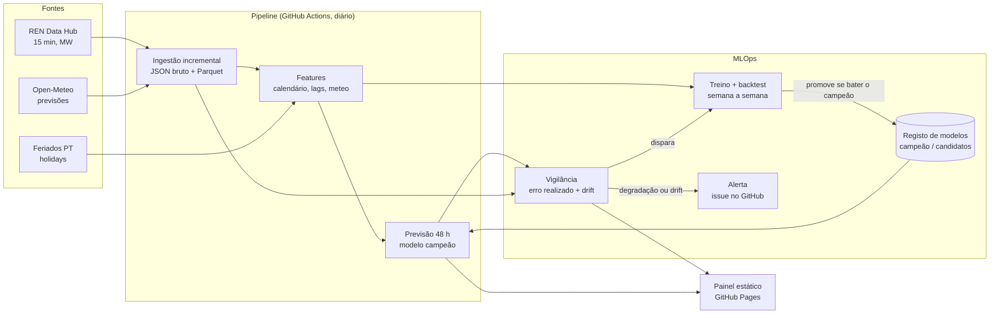

# Previsão da eletricidade em Portugal

Previsão do **consumo** e da **produção eólica e solar** de Portugal continental
para as próximas **24 a 48 horas**, com dados públicos do
[REN Data Hub](https://datahub.ren.pt/), previsões meteorológicas do
[Open-Meteo](https://open-meteo.com/) e o calendário de feriados portugueses.

O objetivo não é só treinar um modelo: é medir, com honestidade, **se ele bate
modelos simples**, e mantê-lo vivo em produção (treino agendado, registo de
modelos, vigilância de drift e da degradação do erro, retreino automático).

> **Painel ao vivo:** <https://joseferrao20.github.io/previsao-eletricidade-pt/>
> (atualizado todos os dias). Todos os números deste README vêm de dados reais
> da REN, processados pelos workflows; nenhum foi escrito à mão.

---

## 1. O problema

A REN, operador da rede de transporte, publica o diagrama de carga a cada 15
minutos: consumo e produção por fonte. Prever estas séries com um a dois dias de
antecedência é útil para quem planeia produção, armazenamento, compras no
mercado diário ou consumo flexível.

| Alvo            | Série REN (15 min, MW)   | Principais fatores               |
|-----------------|--------------------------|----------------------------------|
| `consumo`       | Consumo                  | hora, dia da semana, feriados, temperatura |
| `eolica`        | Eólica                   | vento a 100 m (previsto)         |
| `solar`         | Solar                    | radiação e nebulosidade (previstas), hora solar |

**Formulação.** Todos os dias, à meia-noite (hora de Lisboa), é emitida uma
previsão horária para o dia D e o dia D+1 (horizontes de 1 a 48 h), usando só a
informação disponível nesse momento: valores reais até ao fim de D-1 e
previsões meteorológicas já publicadas antes de D.

## 2. Fontes de dados (verificadas)

| Fonte | Endpoint | Notas |
|-------|----------|-------|
| REN Data Hub | `GET https://servicebus.ren.pt/datahubapi/electricity/ElectricityProductionBreakdownDaily?date=AAAA-MM-DD&culture=pt-PT` | Pública, sem autenticação. JSON tipo Highcharts: `xAxis.categories` (96 intervalos de 15 min) e `series[{name, data}]` em MW. Um pedido por dia. |
| Open-Meteo *Previous Runs* | `GET https://previous-runs-api.open-meteo.com/v1/forecast` com `<variável>_previous_dayN` | Previsões **tal como eram conhecidas N dias antes**. A mesma API serve o treino, o backtest e a produção, por isso o modelo nunca vê meteorologia melhor do que a que teria. Variáveis: temperatura, vento a 100 m, radiação, nebulosidade, em 24 pontos (população, serras com parques eólicos, zonas fotovoltaicas). |
| Feriados | biblioteca [`holidays`](https://pypi.org/project/holidays/) (`PT`) | Regras locais, sem dependência de rede. |

Os endpoints foram confirmados em código público de vários projetos
independentes que usam a mesma API. O formato exato das séries (nomes em
`pt-PT`, mudanças de hora) é validado na ingestão, que falha explicitamente
quando algo não bate certo, em vez de adivinhar (ver `docs/PLANO.md`).

## 3. Arquitetura



## 4. Avaliação honesta

- **Backtest semana a semana** (*rolling origin*): para cada semana de teste, o
  modelo é treinado só com dados anteriores e prevê cada dia dessa semana com a
  mesma regra de emissão usada em produção.
- **Modelos de referência**, avaliados nas mesmas origens e horizontes:
  - *naive sazonal*: o valor à mesma hora, 7 dias antes;
  - *média da semana anterior*: média da mesma hora nos 7 dias antes da emissão;
  - *persistência diária*: o valor à mesma hora no último dia conhecido.
- **Métricas:** MAE (MW), MAPE e sMAPE (%), por alvo e por horizonte
  (D vs. D+1). No solar, o MAPE e o sMAPE são calculados só nas horas com
  produção acima de 100 MW: perto de zero, ambos explodem (no sMAPE, cada hora
  noturna com 1 MW previsto vale 200 %). A tabela indica-o.
- **Skill** face ao naive sazonal: `1 - MAE_modelo / MAE_naive_sazonal`. Como o
  naive nem sempre é a referência mais forte, a leitura abaixo compara também
  com o melhor modelo simples de cada alvo.

### Resultados

A tabela entre os marcadores é escrita por
`eletricidade backtest --atualizar-readme` (workflow `retreino`, todos os
domingos), por isso pode ter números mais recentes do que a análise que se lhe
segue.

<!-- RESULTADOS:INICIO -->
Backtest semana a semana: 52 semanas de teste, de 2025-11-03 a 2026-11-01; horizontes D e D+1 agregados. MAPE e sMAPE do solar só nas horas com mais de 100 MW.

| Alvo | Modelo | MAE (MW) | MAPE | sMAPE | Skill vs. naive sazonal |
|------|--------|---------:|-----:|------:|------------------------:|
| consumo | **LightGBM** | 230 | 3.7% | 3.7% | +34.5% |
| consumo | Naive sazonal (7 dias) | 351 | 5.6% | 5.5% | +0.0% |
| consumo | Média da semana anterior | 469 | 7.7% | 7.5% | -33.7% |
| consumo | Persistência (D-1) | 556 | 9.1% | 9.0% | -58.6% |
| eolica | **LightGBM** | 542 | 102.5% | 47.9% | +51.2% |
| eolica | Naive sazonal (7 dias) | 1111 | 212.9% | 79.0% | +0.0% |
| eolica | Média da semana anterior | 854 | 192.6% | 63.9% | +23.1% |
| eolica | Persistência (D-1) | 920 | 176.1% | 68.3% | +17.1% |
| solar | **LightGBM** | 132 | 24.2% | 21.7% | +39.6% |
| solar | Naive sazonal (7 dias) | 219 | 43.9% | 37.1% | +0.0% |
| solar | Média da semana anterior | 175 | 34.8% | 27.7% | +20.1% |
| solar | Persistência (D-1) | 189 | 36.6% | 31.0% | +13.8% |
<!-- RESULTADOS:FIM -->

**Leitura** (backtest de 2026-11-05: 52 semanas, de novembro de 2025 a
novembro de 2026, 8728 previsões por alvo e horizonte):

| Alvo | MAE LightGBM, D / D+1 | Melhor modelo simples (MAE) | Skill vs. melhor simples |
|------|----------------------:|-----------------------------|-------------------------:|
| consumo | 215 / 244 MW | naive sazonal (351) | +35 % |
| eolica | 518 / 566 MW | média da semana anterior (854) | +37 % |
| solar | 126 / 139 MW | média da semana anterior (175) | +25 % |

- **Consumo:** MAPE de 3,7 % num ano inteiro. O naive sazonal é a referência
  mais forte, porque já capta o padrão semanal; a persistência (D-1) é a pior,
  sobretudo em D+1 (679 MW), porque ignora o fim de semana.
- **Eólica:** o vento previsto é informação que nenhum modelo simples tem. O
  MAPE (~100 %) é enganador: há muitas horas com pouca produção, onde o erro
  relativo explode. Para a eólica, o MAE é a métrica que conta.
- **Solar:** o MAPE subiu de 17 % (só maio a novembro) para 24 % com o
  inverno incluído: os dias de inverno produzem pouco, e o erro relativo pesa mais.
- De D para D+1 o erro sobe 9 a 13 %, coerente com a meteorologia mais antiga
  (previsão feita 3 dias antes em vez de 2).

### Onde o modelo ganha

<!-- ANALISE:INICIO -->
MAE (MW) por segmento nas mesmas 52 semanas, horizontes D e D+1 agregados. *Melhor simples* é a melhor das três referências **dentro de cada segmento**, escolhida depois de ver o resultado (comparação deliberadamente exigente). A meteorologia é a prevista na emissão, por isso os segmentos são conhecidos de antemão.

**consumo**

| Segmento | | Previsões | LightGBM | Naive sazonal | Melhor simples | Skill vs. melhor |
|---|---|---:|---:|---:|---:|---:|
| Estação | inverno | 4 320 | 355 | 490 | 490 (naive) | +28% |
| Estação | primavera | 4 400 | 179 | 311 | 311 (naive) | +43% |
| Estação | verão | 4 416 | 204 | 327 | 327 (naive) | +38% |
| Estação | outono | 4 320 | 184 | 277 | 277 (naive) | +34% |
| Tipo de dia | dia útil | 11 896 | 226 | 350 | 350 (naive) | +36% |
| Tipo de dia | fim de semana | 4 796 | 240 | 302 | 302 (naive) | +20% |
| Tipo de dia | feriado | 620 | 217 | 689 | 689 (naive) | +69% |
| Tipo de dia | ponte | 144 | 276 | 554 | 333 (média sem.) | +17% |
| Temperatura prevista | < 10 °C | 1 712 | 299 | 400 | 400 (naive) | +25% |
| Temperatura prevista | 10–20 °C | 10 947 | 226 | 337 | 337 (naive) | +33% |
| Temperatura prevista | 20–28 °C | 4 268 | 201 | 339 | 339 (naive) | +41% |
| Temperatura prevista | ≥ 28 °C | 529 | 314 | 569 | 569 (naive) | +45% |

**eolica**

| Segmento | | Previsões | LightGBM | Naive sazonal | Melhor simples | Skill vs. melhor |
|---|---|---:|---:|---:|---:|---:|
| Estação | inverno | 4 320 | 696 | 1500 | 1092 (média sem.) | +36% |
| Estação | primavera | 4 400 | 563 | 1135 | 853 (média sem.) | +34% |
| Estação | verão | 4 416 | 383 | 690 | 557 (média sem.) | +31% |
| Estação | outono | 4 320 | 530 | 1128 | 921 (média sem.) | +42% |
| Tipo de dia | dia útil | 11 896 | 532 | 1121 | 862 (média sem.) | +38% |
| Tipo de dia | fim de semana | 4 796 | 545 | 1050 | 828 (média sem.) | +34% |
| Tipo de dia | feriado | 620 | 714 | 1273 | 814 (persist.) | +12% |
| Tipo de dia | ponte | 144 | 538 | 1539 | 1264 (média sem.) | +57% |
| Vento previsto a 100 m | < 4 m/s | 10 378 | 481 | 1004 | 756 (média sem.) | +36% |
| Vento previsto a 100 m | 4–8 m/s | 5 800 | 654 | 1158 | 889 (média sem.) | +26% |
| Vento previsto a 100 m | 8–12 m/s | 1 038 | 567 | 1819 | 1422 (persist.) | +60% |
| Vento previsto a 100 m | ≥ 12 m/s | 240 | 366 | 1499 | 1146 (persist.) | +68% |

**solar**

| Segmento | | Previsões | LightGBM | Naive sazonal | Melhor simples | Skill vs. melhor |
|---|---|---:|---:|---:|---:|---:|
| Estação | inverno | 4 320 | 103 | 205 | 150 (média sem.) | +31% |
| Estação | primavera | 4 400 | 144 | 222 | 177 (média sem.) | +19% |
| Estação | verão | 4 416 | 149 | 219 | 190 (média sem.) | +21% |
| Estação | outono | 4 320 | 132 | 229 | 182 (média sem.) | +27% |
| Tipo de dia | dia útil | 11 896 | 130 | 222 | 176 (média sem.) | +26% |
| Tipo de dia | fim de semana | 4 796 | 140 | 210 | 174 (média sem.) | +20% |
| Tipo de dia | feriado | 620 | 114 | 203 | 142 (média sem.) | +19% |
| Tipo de dia | ponte | 144 | 120 | 272 | 196 (persist.) | +39% |
| Nebulosidade prevista (horas de sol) | < 20 % | 2 710 | 259 | 430 | 353 (persist.) | +27% |
| Nebulosidade prevista (horas de sol) | 20–60 % | 1 833 | 282 | 420 | 342 (média sem.) | +18% |
| Nebulosidade prevista (horas de sol) | ≥ 60 % | 3 351 | 290 | 496 | 385 (média sem.) | +25% |
<!-- ANALISE:FIM -->

**O que a análise mostra** (mesmo backtest de 2026-11-05):

- **Feriados:** é onde o consumo mais ganha (+69 %: 217 vs. 689 MW). O naive
  usa o mesmo dia da semana anterior, que foi dia útil; o modelo sabe que é
  feriado. As pontes são poucas (144 previsões, cerca de 3 dias), por isso o
  +17 % aí vale pouco como evidência.
- **Inverno e frio:** é a época mais difícil para o consumo (MAE 355 MW, contra
  180 a 205 MW nas outras estações). Abaixo de 10 °C previstos o ganho cai
  para +25 %, e acima de 28 °C sobe para +45 %. O aquecimento parece mais
  difícil de prever do que o arrefecimento. É o primeiro sítio onde procurar
  melhorias.
- **Eólica:** ganha entre +31 % e +42 % em todas as estações, e mais (+60 % a
  +68 %) quando o vento previsto é forte, onde as referências falham mais. Nos
  feriados o ganho é só de +12 %, com uma amostra curta (cerca de 13 dias).
- **Solar:** a hipótese anterior (o modelo só ajudaria com nuvens) **não se
  confirma**. O ganho é parecido com céu limpo (+27 %) e muito nublado
  (+25 %), e é menor com nuvens parciais (+18 %), que são o caso mais difícil.
  Por estação, ganha mais no inverno (+31 %) do que na primavera e no verão
  (+19 a 21 %).
- **Vento fraco nos pontos (resolvido):** em 60 % das horas, o vento previsto
  nos 3 pontos iniciais ficava abaixo de 4 m/s a 100 m. Isto apontava para
  pontos mal escolhidos. A experiência seguinte confirmou-o.

#### Experiência: pontos meteorológicos onde está a produção

Antes havia 3 pontos de vento e 3 de sol, e o modelo via só a média de cada
grupo. Agora há 12 pontos nas serras onde se concentram os parques eólicos
(Caramulo, Freita, Montemuro, Alvão, Barroso, Arga, Guarda, Gardunha, Lousã,
Candeeiros, Oeste, Monchique) e 10 nas zonas fotovoltaicas (incluindo Lisboa e
Porto, pela produção em telhados). O LightGBM recebe a série de cada ponto e
aprende o peso de cada um com os dados de treino de cada semana do backtest:
nenhum valor de potência instalada é imposto. A eólica recebe também um proxy de
potência, a média por ponto de min(v, 13 m/s)³: a curva de potência não é
linear, e a média dos cubos não é o cubo da média.

Mesmas 52 semanas, mesmas horas (workflow `avaliar`, `main` contra o branch):

| Alvo | MAE antes | MAE depois | Variação |
|---|---:|---:|---:|
| eolica | 542 MW | 355 MW | **−34 %** |
| solar | 132 MW | 120 MW | −9 % |
| consumo | 230 MW | 230 MW | 0 % (não mudou nada para o consumo) |

Porque é que o vento previsto é tão fraco mesmo nas serras (mediana de 3 a 4 m/s
no Caramulo, na Freita e no Alvão)? A explicação mais provável é a resolução do
modelo meteorológico: cada célula da grelha mistura vales e cumeadas, e as
cumeadas, onde estão os aerogeradores, ficam suavizadas. O nível absoluto sai
baixo, mas as variações continuam informativas, e o modelo aprende a escala. É
coerente com o ganho de 34 %.

#### Experiência: frio e inércia térmica no consumo

A análise por segmento apontava o inverno e o frio como o ponto fraco do
consumo. Juntaram-se features de temperatura ao nível do dia, todas conhecidas na
emissão:
- mínima, máxima e média previstas do dia alvo;
- graus-dia de aquecimento (base 16 °C) e de arrefecimento (base 22 °C);
- inércia térmica: média e graus-dia de aquecimento dos 3 dias anteriores, da
  corrida de 2 dias antes. Um teste garante que a inércia não usa a previsão do
  próprio dia alvo.

Mesmas 52 semanas e mesmas horas:

| Consumo | MAE antes | MAE depois | Variação |
|---|---:|---:|---:|
| Total | 230 MW | 207 MW | **−10 %** |
| Inverno | 355 MW | 324 MW | −9 % |
| Abaixo de 10 °C | 299 MW | 274 MW | −8 % |
| Acima de 28 °C | 314 MW | 276 MW | −12 % |
| Fim de semana | 240 MW | 202 MW | −16 % |
| Feriados (620 previsões) | 217 MW | 226 MW | +4 % |

Melhora em todas as estações e faixas de temperatura. O inverno continua a ser a
época mais difícil. Nos feriados e nas pontes piora ligeiramente, mas as
amostras são pequenas.

### Intervalos de previsão

Além do valor central, cada previsão traz um intervalo a 80 % (P10–P90): um
LightGBM com perda quantílica para cada limite. Os quantis sozinhos ficaram
**estreitos de mais** no backtest real: o valor real caía dentro em 63–70 % das
horas, e no solar em ~53 %, com 40 % das horas acima do P90, porque a potência
instalada cresce e o passado subestima o futuro. A correção é uma calibração
conformal (CQR assimétrico):
- cada limite é deslocado pelo quantil 90 % dos erros fora da amostra das 12
  semanas anteriores;
- o deslocamento é calculado por alvo, horizonte e hora do dia;
- no backtest, cada semana é calibrada só com as semanas anteriores; em
  produção, com as 12 mais recentes do último backtest.

Resultado na avaliação de 2026-11-09 (52 semanas, menos as 4 primeiras):

| Alvo | Cobertura sem calibrar | Cobertura calibrada | Largura (MW) | Largura do naive ± erros (cobertura) |
|---|---:|---:|---:|---:|
| consumo (D) | 66 % | 77 % | 645 | 1228 (81 %) |
| eolica (D) | 70 % | 78 % | 1007 | 4524 (87 %) |
| solar (D) | 54 % | 81 % | 370 | 783 (79 %) |

Com cobertura parecida, os intervalos do modelo têm entre um quarto e metade
da largura dos do naive. No consumo ficam ainda um pouco abaixo dos 80 %
nominais.

<!-- INTERVALOS:INICIO -->
*Ainda sem resultados: gerados pelo próximo `retreino`.*
<!-- INTERVALOS:FIM -->

## 5. MLOps

| Workflow | Quando | O que faz |
|----------|--------|-----------|
| `ci` | cada *push* / PR | `ruff` + `pytest` no ambiente do `uv.lock`. |
| `diario` | todos os dias, 01:10 UTC | Ingestão incremental (REN + Open-Meteo), previsão a 48 h com o campeão, monitor, painel no GitHub Pages. Se o monitor der alerta, abre/atualiza uma *issue* `alerta-modelo` e dispara o `retreino`. |
| `retreino` | domingos + a pedido do monitor | Backtest de 52 semanas (atualiza as tabelas de resultados e de análise deste README), treina candidatos e aplica a regra de promoção. |

**Registo de modelos** (`src/eletricidade/registo.py`): cada versão guarda o
modelo e um `meta.json` com o período de treino, hiperparâmetros, *seed*,
*commit*, versões das bibliotecas, métricas do backtest e o perfil (decis) das
features usado no cálculo do drift. `campeoes.json` aponta para a versão em
produção e `historico.jsonl` regista cada decisão.

**Regra de promoção.** Um candidato só passa a campeão se, num backtest semana
a semana das últimas 4 semanas, (1) bater o naive sazonal e (2) não for mais de
2 % pior do que o erro **realizado** do campeão nas mesmas horas. Nenhum dos dois
viu esses dados no treino.

**Monitor** (`src/eletricidade/monitor.py`). O erro decide; o drift explica.
- **Alertas** (abrem *issue* e disparam o retreino), em janelas de 7 dias:
  - degradação: MAE realizado > 1,3 × MAE de referência do backtest do campeão;
  - pior do que o naive sazonal nas mesmas horas.
- **Avisos de drift** (aparecem no relatório e no painel, sem retreino): PSI >
  0,25 na meteorologia prevista dos últimos 14 dias face ao **mesmo intervalo
  do calendário** (±7 dias) nos dados anteriores.

A primeira versão comparava a semana recente com todo o treino e em todas as
features. Na primeira execução real deu "drift" em tudo: no mês, no dia do ano,
na temperatura de novembro. Seria um alerta e um retreino por dia. Por isso, o
calendário e os lags do próprio alvo ficaram de fora (a mudança do alvo já se
mede no erro), e a referência passou a ser sazonal.

**Onde fica cada coisa.** O código fica em `main`. O estado de produção
(registo, previsões emitidas, relatórios do monitor, resultados do backtest)
fica no branch `estado`, escrito só pelos workflows. Os JSON brutos da REN e do
Open-Meteo ficam na *cache* do Actions e são reconstruíveis.

## 6. Reprodutibilidade

- Ambiente fixado com [`uv`](https://docs.astral.sh/uv/) (`uv.lock`, `uv sync --frozen`)
  e Python 3.13 (`.python-version`).
- `SEED = 42`, LightGBM com `deterministic=True` e número de *threads* fixo; há
  um teste que corre o backtest duas vezes e exige previsões idênticas.
- Os dados brutos são guardados tal como chegam; o processamento reconstrói-se
  a partir deles (`ren.construir_horario`, `meteo.construir_horario`).
- A meteorologia usa a mesma regra no treino, no backtest e em produção.

## 7. Limitações

Observadas nas primeiras execuções reais:

- Há só um inverno no backtest (2025/26) e só dois anos de histórico. As
  métricas por segmento pequeno (pontes, feriados, vento ≥ 12 m/s) têm
  poucas centenas de previsões e devem ser lidas com cautela.
- O gateway da REN não responde se o pedido tiver `Accept: application/json`
  (fica pendurado até ao timeout). É um comportamento sem documentação, que
  pode mudar. O workflow `diagnostico-rede` serve para o voltar a verificar.
- Alguns dias devolvem 404 de forma intermitente (por exemplo 2024-10-17 na
  primeira tentativa); o *retry* resolve. O dia corrente devolve 404 até a
  REN o publicar.
- O Open-Meteo *Previous Runs* teve vários timeouts nos pedidos mensais; o
  *retry* resolveu todos.

Conhecidas à partida:

- A API da REN não tem documentação formal de contrato: os nomes das séries e o
  formato podem mudar. A ingestão falha de forma explícita em vez de adivinhar.
- Os dias de mudança de hora têm 92 ou 100 intervalos; são tratados em UTC.
- A meteorologia é amostrada em 24 pontos escolhidos geograficamente. O peso de
  cada um é aprendido pelo modelo, não vem de dados de potência instalada por
  concelho.
- Para garantir que nenhuma corrida meteorológica usada é posterior à emissão,
  o alvo em D usa a previsão feita 2 dias antes e D+1 a feita 3 dias antes. Na
  prática existem previsões mais frescas, por isso o erro reportado é
  **conservador**: um sistema operacional poderia fazer um pouco melhor.
- O arquivo de previsões do Open-Meteo só cobre bem 2024 em diante: o histórico
  de treino é curto (pouco mais de dois anos), sobretudo para eventos raros.
- A potência instalada solar cresce depressa: modelos treinados no passado
  subestimam o futuro. É uma das razões para o retreino frequente.
- Termos de utilização: o REN Data Hub não publica licença de reutilização.
  Por isso os dados brutos **não** são versionados; o painel mostra só agregados
  horários recentes, com atribuição.

## 8. Como correr

```bash
uv sync --frozen             # ambiente exatamente igual ao do lock
uv run pytest                # testes (fixtures sintéticas, sem rede)
uv run eletricidade ingest   # download incremental desde 2024-01-01
uv run eletricidade backtest --semanas 52
uv run eletricidade treinar
uv run eletricidade prever
uv run eletricidade monitorizar
uv run eletricidade painel   # gera site/index.html
```

Para ativar no GitHub: *Settings → Pages → Source: GitHub Actions*; depois
correr o workflow `diario` à mão uma vez (o primeiro treino é feito
automaticamente se não houver campeão).

Ver o plano detalhado e a investigação dos dados em [`docs/PLANO.md`](docs/PLANO.md).
